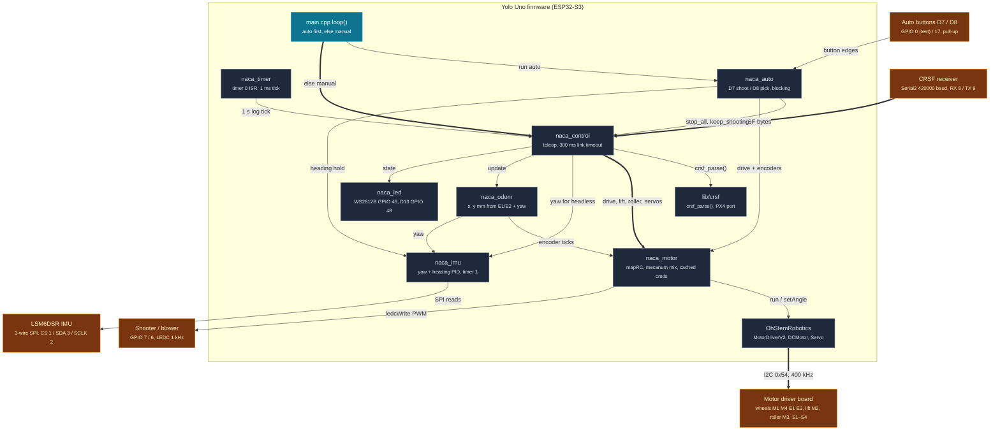

# Nacateam robot firmware

Firmware cho robot thi đấu ORC của Nacateam, chạy trên **OhStem Yolo Uno (ESP32-S3, Arduino framework)**.

- Robot gồm:
  - 4 bánh mecanum
  - cơ cấu nâng, cơ cấu cuốn bóng, shooter, blower
  - 3 servo kẹp và 1 servo xoay bóng
- Robot được điều khiển từ xa qua sóng RC giao thức **CRSF**.
- Hai nút **D7 / D8** chạy hai bài tự động (bắn bóng, gắp khối).

## Build và nạp

PlatformIO chỉ có một environment là `yolo_uno`. Nếu `pio` không có trong PATH, hãy dùng `~/.platformio/penv/Scripts/pio.exe`.

```sh
pio run                 # build
pio run -t upload       # nạp firmware qua native USB
pio device monitor      # log serial 115200 qua USB CDC
pio run -t clean
```

Dự án không có unit test. `pio run` chỉ kiểm tra được là code build qua; hành vi thực tế phải thử trên robot.

## Kiến trúc

Sơ đồ dưới đây chuyển từ sơ đồ archify trong [.archify/architecture-firmware-20261125-081632/firmware.html](.archify/architecture-firmware-20261125-081632/firmware.html). Trang HTML đó có giải thích chi tiết từng khối, có bật tắt theme và xuất được ảnh SVG/PNG. Hãy mở bằng trình duyệt; GitHub chỉ hiện mã nguồn HTML.

Bản đồ code chi tiết hơn theo từng file nằm ở [floorplan/index.html](floorplan/index.html).



Chú thích: khối xanh ngọc là vòng lặp chính, khối xám là module firmware, khối cam là phần cứng. Mũi tên đậm là luồng điều khiển chính.

### Luồng chạy

- `setup()` chỉ gọi `naca_control_init()`.
- `loop()` gọi `naca_auto_handle_loop()` trước. Hàm này trả về false khi không có sườn nút, khi robot đang được kích hoạt bằng CH5 (`>1400`) hoặc khi không có IMU. Lúc đó `loop()` gọi `naca_manual_handle_loop()`.
- **Điều khiển tay:**
  - `naca_control` đọc `Serial2` và giải mã bằng `crsf_parse()`.
  - Lệnh motor chỉ được gửi khi giải mã xong một frame CRSF hoàn chỉnh, nên lưu lượng I2C đi theo tốc độ frame RC.
  - Quá `RC_TIMEOUT_MS` (300 ms) không có frame thì `naca_control_stop_all()` được gọi một lần và LED chuyển xanh dương.
- **Tự động:**
  - D7 chạy khi nhấn (bắn bóng), D8 chạy khi nhả (gắp khối). Bài tự động chạy kiểu chặn.
  - Bài bị hủy khi kích hoạt bằng CH5, khi nhấn lại nút hoặc khi một bước quá `AUTO_STEP_TIMEOUT_MS`.
  - Thông số nằm trong `naca_auto.h`.
- **Khởi động:**
  - `naca_motor_init()` lặp vô hạn nếu board driver không qua bước WHO_AM_I.
  - IMU hiệu chuẩn gyro khoảng 7 giây; robot phải đứng yên trong lúc này.
  - Nếu không có IMU thì mode không đầu và chế độ tự động bị tắt.

### Module

| Thư mục                 | Vai trò                                                                                         |
| ----------------------- | ----------------------------------------------------------------------------------------------- |
| `src/main.cpp`          | Điều phối auto / manual                                                                         |
| `src/naca_control`      | Teleop: đọc RC, ánh xạ kênh thành lệnh di chuyển và cơ cấu, phanh khi nhả cần, timeout mất sóng |
| `src/naca_motor`        | Đối tượng phần cứng, gán chân, `mapRC`, động học mecanum (`omni_kinematics`), hàm motor         |
| `src/naca_auto`         | Hai bài tự động D7 / D8, port từ chương trình OhStem Blockly                                    |
| `src/naca_imu`          | LSM6DSR qua SPI 3 dây, tích phân yaw, PID giữ hướng                                             |
| `src/naca_odom`         | Fuse encoder bánh sau (E1 = RL, E2 = RR) với yaw thành `x`, `y` (mm); hằng số chưa hiệu chỉnh  |
| `src/naca_led`          | LED trạng thái WS2812B và LED D13                                                               |
| `src/naca_timer`        | Hardware timer 0, tick 1 ms cho dòng log mỗi giây                                               |
| `lib/crsf`              | Parser CRSF port từ PX4                                                                         |
| `lib/OhStemRobotics`    | Bản C++ của runtime OhStem; firmware chỉ dùng `MotorDriverV2`, `DCMotor`, `ServoMotor`         |

## Phần cứng

| Chức năng        | Kết nối                                                                          |
| ---------------- | -------------------------------------------------------------------------------- |
| Bộ thu CRSF      | `Serial2`, 420000 baud, RX 8 (D5), TX 9 (D6)                                     |
| Motor driver     | `MotorDriverV2`, I2C `0x54`, SDA 11, SCL 12, 400 kHz                             |
| Bánh mecanum     | FL `M1`, FR `M4` (đảo chiều), RL `E1` (đảo chiều), RR `E2` (đảo chiều)           |
| Nâng / cuốn bóng | `M2` / `M3`                                                                      |
| Shooter / blower | shooter GPIO 7 (D3), blower GPIO 6 (D4), LEDC 1 kHz, 8-bit                       |
| Servo            | kẹp giữa `S1`, kẹp phải `S2`, kẹp trái `S3`, xoay bóng `S4` (servo 360°)         |
| IMU              | LSM6DSR, SPI 3 dây, CS 1 / SDA 3 / SCLK 2                                        |
| Nút tự động      | D7 = GPIO 0 (đang thử, bản gốc là GPIO 10), D8 = GPIO 17, pull-up                |
| LED              | WS2812B GPIO 45, D13 GPIO 48                                                     |

## Kênh RC

Mỗi kênh là một define `*_RC_CHANNEL` trong [src/naca_control/naca_control.h](src/naca_control/naca_control.h), đánh số từ 1 giống mix monitor của tay điều khiển. Muốn đổi kênh thì sửa define đó.

| Kênh | Define                                | Chức năng                                                                |
| ---- | ------------------------------------- | ------------------------------------------------------------------------ |
| CH1  | `ROLL_RC_CHANNEL`                     | cần phải, ngang                                                          |
| CH2  | `PITCH_RC_CHANNEL`                    | cần phải, dọc                                                            |
| CH3  | `THROTTLE_RC_CHANNEL`                 | cần trái, dọc                                                            |
| CH4  | `YAW_RC_CHANNEL`                      | cần trái, ngang                                                          |
| CH5  | `PILOT_MODE_RC_CHANNEL`               | `>1700` `TUAT_VUONG_MODE`, `>1400` `TU_VUONG_MODE`, còn lại `SAFETY_MODE` |
| CH6  | `BOTH_GRIPPER_RC_CHANNEL`             | cả kẹp trái và kẹp phải                                                  |
| CH7  | `MID_GRIPPER_RC_CHANNEL`              | kẹp giữa                                                                 |
| CH8  | `LEFT_GRIPPER_RC_CHANNEL`             | kẹp trái                                                                 |
| CH9  | `RIGHT_GRIPPER_RC_CHANNEL`            | kẹp phải                                                                 |
| CH10 | `SINGLE_SERVO_PICKUP_BALL_RC_CHANNEL` | kẹp bóng đơn bên trái hoặc phải                                          |
| CH11 | `HEADLESS_RC_CHANNEL`                 | mode không đầu (`>1700`)                                                 |
| CH13 | `SPECIAL_GRIPPER_RC_CHANNEL`          | đổi kẹp phải + giữa giữa special-close và close                          |
| CH14 | `SPEED_MODE_RC_CHANNEL`               | `>1700` `SPEED_MODE_1` (150), còn lại `SPEED_MODE_0` (50)                |
| CH15 | `SCROLL_RC_CHANNEL`                   | cuốn bóng                                                                |
| CH16 | `BLOWER_SHOOTER_RC_CHANNEL`           | shooter + blower                                                         |

`TU_VUONG_MODE` và `TUAT_VUONG_MODE` gán các cần CH1–CH4 cho đi ngang, tiến/lùi, xoay và nâng theo hai kiểu khác nhau.

## Thông số hay chỉnh

| Define                                    | File                                                         | Ý nghĩa                                                                                  |
| ----------------------------------------- | ------------------------------------------------------------ | ---------------------------------------------------------------------------------------- |
| `VX_BRAKE_MS`, `VR_BRAKE_MS`              | [src/naca_motor/naca_motor.h](src/naca_motor/naca_motor.h)   | Thời gian phanh khi nhả cần tiến/lùi hoặc xoay về 0                                      |
| `LIFT_HOLD_SPEED`                         | [src/naca_motor/naca_motor.h](src/naca_motor/naca_motor.h)   | Lực giữ cơ cấu nâng khi cần ở giữa và khi mất sóng                                       |
| `RC_TIMEOUT_MS`, `HEADLESS_YAW_SIGN`      | [src/naca_control/naca_control.h](src/naca_control/naca_control.h) | Timeout mất sóng, dấu bù xoay của mode không đầu                                   |
| `SPEED_MODE_0`, `SPEED_MODE_1`            | [src/nacateam/nacateam_crsf_define.h](src/nacateam/nacateam_crsf_define.h) | Tốc độ cần ở hai chế độ                                                    |
| `AUTO_*`                                  | [src/naca_auto/naca_auto.h](src/naca_auto/naca_auto.h)       | Thông số hai bài tự động                                                                 |
| `NACA_LED_BATTERY_LOW_V`                  | [src/naca_led/naca_led.h](src/naca_led/naca_led.h)           | Ngưỡng báo pin yếu (11.5 V)                                                              |

## LED trạng thái

Màu LED WS2812B:

| Màu                 | Trạng thái                             |
| ------------------- | -------------------------------------- |
| đỏ                  | đang khởi động                         |
| xanh dương          | chưa có sóng hoặc mất sóng             |
| vàng                | `SAFETY_MODE`                          |
| xanh lá             | đã kích hoạt                           |
| xanh ngọc           | bật mode không đầu                     |
| trắng / tím         | đang chạy bài tự động nút xanh / đỏ    |
| nháy đỏ xen kẽ      | pin yếu                                |

LED D13 nháy đều khi điều khiển tay và sáng liên tục khi chạy tự động.

## File không thuộc bản build

- `include/AppConfig.h`: còn từ bản demo PS4 của OhStem. File vẫn được include nhưng không có hằng số nào được dùng.
- `src/main.cpptxt` (demo PS4) và `src/test_crsf.cppok` (in kênh CRSF):
  - PlatformIO không biên dịch hai file này vì đuôi file.
  - Muốn dùng thì đổi sang đuôi `.cpp` và đưa `src/main.cpp` ra khỏi bản build.
- `lib/OhStemRobotics/DCMotor.{cpp,h}` ở gốc thư viện là bản cũ; code được build nằm trong `lib/OhStemRobotics/src/`.
- `Arduino IDE Library/`: bản sao riêng cho Arduino IDE, đã khác với `lib/`.
